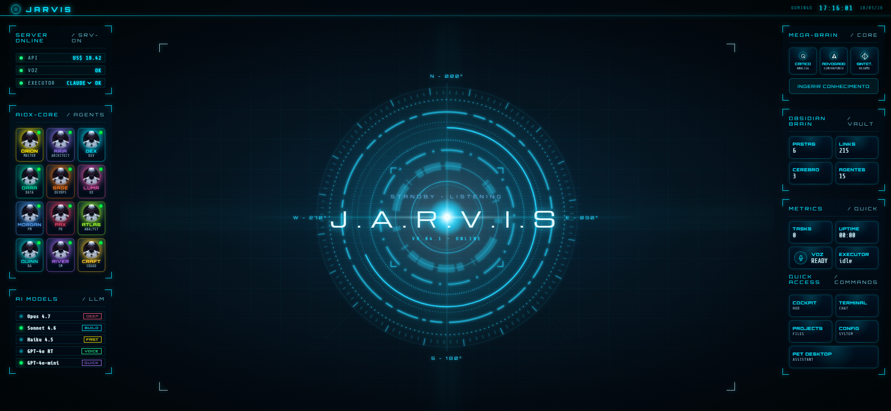

# ServicesBI Jarvis



Assistente operacional local com HUD futurista, comandos por voz, 12 agentes de IA, integração Claude/Codex, Obsidian, automações e execução de protocolos.

> Projeto privado em desenvolvimento pela ServicesBI.

---

## Visão geral

O **ServicesBI Jarvis** é um assistente operacional local criado para atuar como uma central de comando inteligente.

A proposta do projeto é unir:

- HUD visual futurista;
- comandos por voz;
- integração com Claude e Codex;
- agentes especializados de IA;
- Obsidian Brain;
- Mega-Brain;
- criação e análise de arquivos;
- geração de planilhas e relatórios;
- protocolos operacionais;
- automações futuras com ERP, SaaS, Excel, Power BI e PDF.

O objetivo é evoluir o Jarvis de uma interface visual para um **assistente operacional real**, capaz de receber comandos, interpretar contexto, acionar agentes especializados e executar rotinas com segurança.

---

## Diferencial: AIOX-CORE com 12 agentes de IA

O Jarvis não funciona apenas como um chatbot. Ele opera com uma arquitetura baseada em **12 agentes especializados**, organizados no núcleo **AIOX-CORE**.

Cada agente possui uma função específica dentro do fluxo de análise, desenvolvimento, decisão e execução.

| Agente | Papel | Responsabilidade |
|---|---|---|
| **Orion** | Master | Coordena o núcleo de agentes, organiza prioridades e direciona tarefas complexas. |
| **Aria** | Architect | Atua na arquitetura de sistemas, estrutura de projetos, fluxos e decisões técnicas. |
| **Dex** | Dev | Apoia desenvolvimento, código, correções, implementação e integração técnica. |
| **Dara** | Data | Atua com dados, análises, métricas, planilhas, indicadores e estruturação analítica. |
| **Gage** | DevOps | Apoia ambiente, deploy, scripts, automações, serviços locais e infraestrutura. |
| **Uma** | UX | Avalia interface, usabilidade, experiência visual e consistência do HUD. |
| **Morgan** | PM | Organiza escopo, fases, entregas, prioridades e acompanhamento do projeto. |
| **Pax** | PO | Traduz necessidades do usuário em requisitos, regras de negócio e critérios de aceite. |
| **Atlas** | Analyst | Faz análise funcional, diagnóstico, documentação e interpretação de problemas. |
| **Quinn** | QA | Valida qualidade, testa fluxos, identifica regressões e garante estabilidade. |
| **River** | SM | Apoia o fluxo de trabalho, organização das etapas e disciplina operacional. |
| **Craft** | Squad Creator | Monta squads/agentes conforme o tipo de tarefa e necessidade do usuário. |

---

## Principais recursos

- HUD futurista local.
- Comandos por voz.
- Executor com modos **AUTO / CLAUDE / CODEX**.
- Integração com Claude.
- Integração com Codex.
- Obsidian Brain para organização de conhecimento.
- Mega-Brain para análise e apoio à decisão.
- Criação controlada de arquivos.
- Geração de planilhas Excel.
- Base para geração futura de PDF.
- Protocolos operacionais reutilizáveis.
- Estrutura futura para integração com ERP e SaaS.
- Estrutura futura para Power BI, Excel, automações e relatórios.

---

## Protocolos operacionais

O Jarvis está sendo estruturado para executar protocolos por comando de voz ou texto.

Exemplo de comando esperado:

```text
Jarvis, executar protocolo trabalho.
